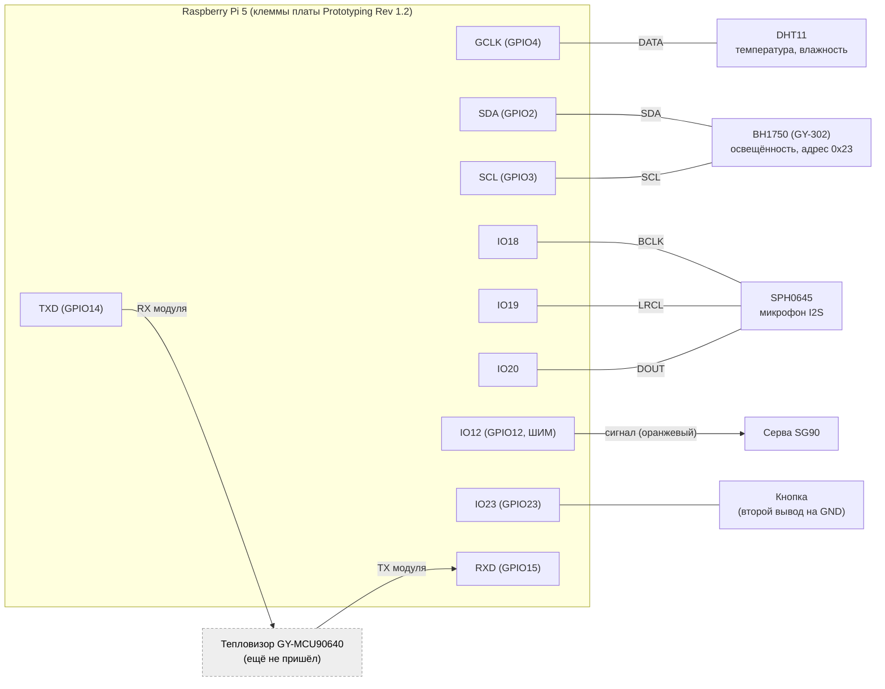
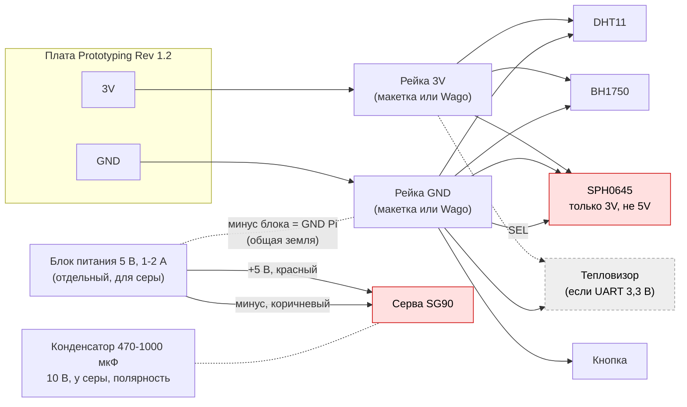

# spa - проверка соответствия жилого помещения нормам СанПиН 1.2.3685-21

Учебный проект (название `spa` расшифровывается как SanPinAudit). Цель: комплекс на
Raspberry Pi измеряет параметры жилого помещения и сравнивает их с нормативами
СанПиН 1.2.3685-21.

Сейчас реализован первый этап, сбор данных: датчик DHT11 (температура и влажность)
подключён к Raspberry Pi 5, маленькое Python-приложение читает его и отдаёт значения по HTTP,
VictoriaMetrics их собирает, Grafana рисует графики. Всё это на хост ставит Ansible одной
командой. Сравнения с нормативами пока нет, см. раздел «Что ещё не сделано».

> Результаты измерений этого комплекса не заменяют официальных замеров аккредитованной
> лабораторией. Датчик DHT11 бытовой, его погрешность порядка ±2 °C по температуре и
> ±5 % по влажности.

## Что проверяем

| Фактор | Норматив | Чем измеряем | Статус |
|---|---|---|---|
| Температура воздуха в жилых комнатах | допустимо от +18 до +24 °C; оптимально +20…+22 °C в холодный период и +22…+25 °C в тёплый | DHT11 | есть |
| Относительная влажность воздуха | 40–60 % | DHT11 | есть |
| Освещённость | в этой версии норматив не проверяется | BH1750 (GY-302) | код есть, датчик не подключён |
| Уровень шума днём (с 7:00 до 23:00) | не более 55 дБ | датчик шума | планируется |
| Уровень шума ночью (с 23:00 до 7:00) | не более 45 дБ | датчик шума | планируется |

Пороги в таблице внесены со слов автора проекта и ещё не сверены с текстом СанПиН
1.2.3685-21. Перед использованием в расчётах их нужно проверить по самому документу.

## Как это работает

    DHT11 --GPIO4--> app/ (Python, :7777) <--опрос раз в 10 с-- VictoriaMetrics (:8428) <-- Grafana (:3000)

Логи идут отдельным путём:

    app/ и контейнеры --> journald хоста --> systemd-journal-upload --> VictoriaLogs (:9428) <-- Grafana

- `app/` — экспортер на Python. Работает на хосте, а не в контейнере: так проще дотянуться до GPIO.
  - `/metrics` — метрики в формате Prometheus (температура, влажность, состояние датчика);
  - `/health` — JSON со статусом приложения и каждого датчика;
  - `/reports` — заглушка (ответ 501), пока не реализовано.
- `ansible/roles/monitoring_stack` — Grafana, VictoriaMetrics и VictoriaLogs в docker compose,
  готовые дашборды.
- `ansible/roles/spa_app` — копирует `app/` на хост, создаёт venv и systemd-юнит.
- `ansible/roles/log_shipping` — ставит `systemd-journal-upload`, который пересылает журнал хоста
  в VictoriaLogs.
- `ansible/roles/docker` — ставит Docker Engine из репозиториев Debian и Docker Compose v5.6.1
  с GitHub Releases (версия задаётся одной строкой в `ansible/roles/docker/defaults/main.yml`).

## Структура репозитория

    app/                 исходный код экспортера (единственная копия)
      main.py            HTTP-сервер и фоновый опрос датчиков
      config.yaml        настройки: порт, интервал опроса, список датчиков
      metrics.py         описание метрик
      health.py          состояние для /health
      sensors/           датчики (dht11.py читает DHT11 по GPIO)
    ansible/             развёртывание на хост
      roles/docker/            Docker Engine и Compose
      roles/monitoring_stack/  Grafana + VictoriaMetrics + VictoriaLogs (файлы в files/)
      roles/spa_app/           приложение и systemd-юнит
      roles/log_shipping/      отправка журнала хоста в VictoriaLogs

## Метрики

| Метрика | Что значит |
|---|---|
| `spa_temperature_celsius{sensor}` | температура, °C |
| `spa_humidity_percent{sensor}` | влажность, % |
| `spa_illuminance_lux{sensor}` | освещённость, лк (BH1750) |
| `spa_sensor_up{sensor}` | 1, если последний опрос удался, иначе 0 |
| `spa_sensor_last_read_timestamp_seconds{sensor}` | время последней попытки чтения |
| `spa_sensor_read_errors_total{sensor}` | число неудачных чтений |
| `spa_sensor_reconnects_total{sensor}` | сколько раз приложение программно переподключало датчик |
| `spa_servo_angle_degrees` | текущий угол сервопривода, градусы |
| `spa_collection_enabled` | включён ли сбор (сейчас всегда 1) |

DHT11 иногда отвечает с неверной контрольной суммой. Это нормально: чтение выполняется
программно, и тайминги не идеальны. Поэтому за один опрос приложение пробует прочитать датчик
до 3 раз (пауза 1,1 с) и пишет предупреждение в журнал, только если не удалась ни одна попытка.
Показания вне диапазона измерений DHT11 по даташиту (влажность вне 20–90 %, температура вне
0–50 °C) тоже считаются ошибкой чтения: раньше такой мусор проходил контрольную сумму и попадал
в графики.

При неудачном чтении значения температуры и влажности этого датчика пропадают из `/metrics`
(в Grafana на графике разрыв, а не линия из последнего удачного значения), остаются только
`spa_sensor_up=0` и счётчики ошибок. Если датчик не читается 3 опроса подряд, приложение
переподключает его: освобождает пин GPIO, ждёт 2 с и настраивает заново, не чаще раза в минуту.
Это программный сброс: питание датчика идёт с фиксированного пина 3V и не отключается, поэтому
аппаратный сбой (например, залипание влажности на 10 %) он не лечит.

## Сервопривод

Сервопривод SG90 вращает платформу на 0–180°. Включается в `app/config.yaml` (`servo.enabled: true`),
сигнал на клемму IO12 (GPIO12, аппаратный ШИМ), питание отдельным блоком 5 В, земля общая с Pi.

    curl http://<хост>:7777/servo                                  # текущий угол
    curl -X POST -d '{"angle": 90}' http://<хост>:7777/servo      # повернуть на 90°

    curl -X POST http://<хост>:7777/servo/sweep                   # проход 0° -> 180° -> 0°

Проход можно запустить и физической кнопкой (`button.enabled: true`, кнопка между GPIO23 и GND).
Пока проход идёт, повторное нажатие и повторный запрос игнорируются (HTTP 409).

Угол проверяется (число от `min_angle` до `max_angle`), поворот плавный (`speed_deg_per_s`).
Текущий угол есть в метрике `spa_servo_angle_degrees`; пока команд не было, метрики нет, потому что
реальное положение сервы после включения неизвестно. У `/servo` нет аутентификации, как и у остальных
портов: в интернет его публиковать нельзя.

## Схема подключения

Подписи клемм по плате Prototyping Rev 1.2. Серая рамка с пунктиром: оборудование, которое ещё не
пришло. Красным выделено то, что нельзя подключать к 5 В или без общей земли.

### Сигнальные провода

### Питание и земля

Питание и земля общие для нескольких устройств, а клемма 3V на плате одна. Поэтому нужны рейки
(мини-макетка или клеммы Wago): так схема остаётся читаемой.

Картинки тех же схем лежат в `docs/` (`wiring-signals.png`, `wiring-power.png`), исходники Mermaid
рядом (`*.mmd`). Перерисовка: `mmdc -i docs/wiring-signals.mmd -o docs/wiring-signals.png -b white -w 1200`
(пакет `@mermaid-js/mermaid-cli`).

Правила, которые схема не показывает:
- Все работы при выключенном и отсоединённом питании Pi.
- Серву подключайте и отключайте только при выключенном питании. Плюс блока 5 В с клеммами 5V и 3V
  платы не соединяйте.
- Перед включением прозвоните, что рейки 3V и GND между собой не звонятся.
- У тепловизора сначала сверьте уровень UART (3,3 В или 5 В): 5 В на RXD сожжёт Pi.

## Что нужно

- Raspberry Pi 5 с Debian 13 (trixie), пакет `python3-rpi-lgpio` (даёт совместимый `RPi.GPIO` для чипа RP1).
- Датчик DHT11: питание 3V (не 5V!), земля, сигнал на BCM GPIO4.
- На машине, с которой запускаете деплой: Ansible и SSH-доступ к хосту.

## Запуск на хосте

1. Впишите адрес и пользователя хоста в `ansible/inventory.ini`.
2. Пароли не лежат в репозитории. Передайте их через переменные окружения:
   - `SPA_SSH_PASS` — пароль SSH и sudo пользователя на хосте;
   - `GF_ADMIN_PASS` — пароль администратора Grafana.
3. Запустите из каталога `ansible/`:

        ansible-playbook -i inventory.ini playbook.yml

   Только приложение: `--tags app`. Теги: `docker`, `monitoring`, `app`, `logs`.
   Повторный запуск безопасен: если ничего не изменилось, Ansible ничего не тронет.

## Проверка

    curl http://<хост>:7777/health     # статус приложения и датчика
    curl http://<хост>:7777/metrics    # метрики
    curl http://<хост>:8428/targets    # VictoriaMetrics видит экспортер (job=sensors)

Grafana: `http://<хост>:3000`, логин `admin`, пароль из `GF_ADMIN_PASS`.
Дашборд `spa-sensors` создаётся автоматически. JSON не поддерживает комментарии,
поэтому коротко о нём здесь: файл `spa-sensors.json` лежит в
`ansible/roles/monitoring_stack/files/provisioning/dashboards/`, Grafana подхватывает его
через `dashboards.yml` из того же каталога, а данные берёт из источника
`VictoriaMetrics` (его `uid` указан в `provisioning/datasources/victoriametrics.yml`
и должен совпадать с `uid` в JSON).

## Логи

Логи приложения `spa` и контейнеров попадают в журнал systemd (контейнеры через драйвер
`journald`, поэтому `docker logs` продолжает работать). Служба `systemd-journal-upload`
пересылает журнал в VictoriaLogs, срок хранения 30 дней (`-retentionPeriod=30d` в
`docker-compose.yml`).

В Grafana источник данных `VictoriaLogs` создаётся автоматически, а дашборд `SPA — Логи`
(`spa-logs.json`, лежит рядом с `spa-sensors.json`) показывает число ошибок, объём логов по
источникам и сами логи `spa`, VictoriaMetrics и VictoriaLogs. Запросы к логам пишутся на языке
LogsQL, например `_SYSTEMD_UNIT:"spa-monitoring.service"`. Плагин источника ставится при старте
Grafana через `GF_INSTALL_PLUGINS`, для этого хосту нужен доступ в интернет.

    curl http://<хост>:9428/health     # VictoriaLogs работает
    curl http://<хост>:9428/select/logsql/query -d 'query=_SYSTEMD_UNIT:"spa-monitoring.service"' -d limit=5

## Безопасность

Порты 3000, 8428 и 9428 открыты в локальную сеть, а у VictoriaMetrics и VictoriaLogs нет
аутентификации. Для домашней сети это сознательный выбор, в интернет их публиковать нельзя.

`systemd-journal-upload` отправляет в VictoriaLogs весь журнал хоста, а не только логи проекта.
Туда попадают и записи `sshd` и `sudo` (с текстом выполненных команд), которые видны всем, кто
имеет доступ к порту 9428.

## Что ещё не сделано

- Сравнение с нормативами СанПиН: сейчас приложение только собирает данные. Нужны правила
  «в норме / вне нормы» для каждого измеряемого параметра и отображение результата в Grafana.
- Эндпоинт `/reports`.
- Остальные датчики: сейчас подключён только DHT11. Нужен датчик уровня шума (с учётом
  дневных и ночных норм).
- Тепловизор для замера перепадов температуры стен. Вместе с вращающейся платформой он должен
  обойти помещение, поэтому зависит от пункта про двигатель ниже.
- Кнопка запуска замеров: пока сбор включён всегда (`collection.always_on: true`).
- Двигатель (сервопривод SG90): управление готово, но физически серва ещё не подключена.
