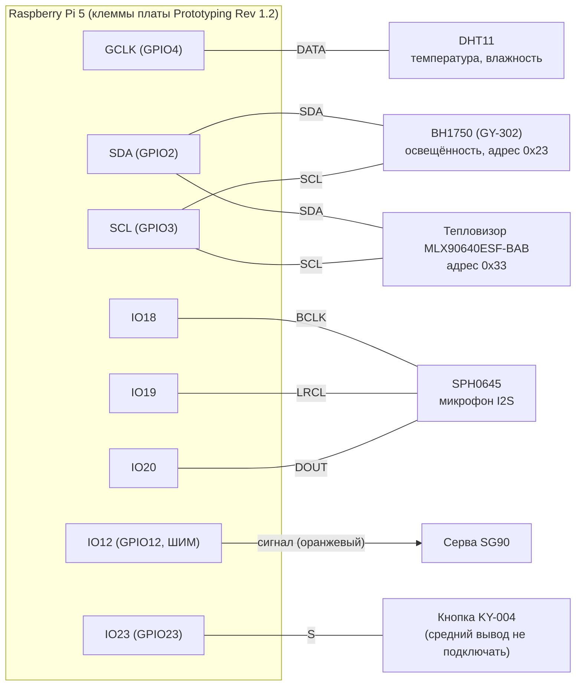
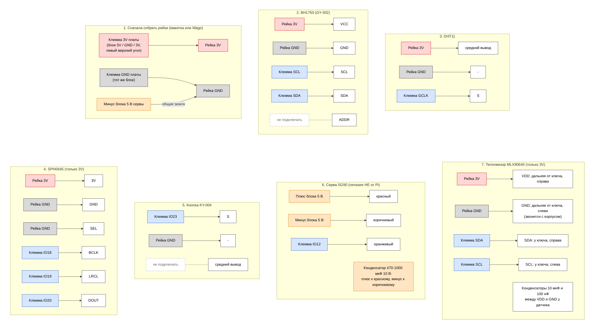

# spa - проверка соответствия жилого помещения нормам СанПиН 1.2.3685-21

Учебный проект (название `spa` расшифровывается как SanPinAudit). Цель: комплекс на
Raspberry Pi измеряет параметры жилого помещения и сравнивает их с нормативами
СанПиН 1.2.3685-21.

Сейчас реализован первый этап, сбор данных: датчик DHT11 (температура и влажность)
подключён к Raspberry Pi 5, маленькое Python-приложение читает его и отдаёт значения по HTTP,
VictoriaMetrics их собирает, Grafana рисует графики. Всё это на хост ставит Ansible одной
командой. Отчёт по каждому замеру с нормативами СанПиН открывается на `/reports`; автоматической
оценки «в норме / вне нормы» пока нет.

> Результаты измерений этого комплекса не заменяют официальных замеров аккредитованной
> лабораторией. Датчик DHT11 бытовой, его погрешность порядка ±2 °C по температуре и
> ±5 % по влажности.

## Что проверяем

| Фактор | Норматив для жилой комнаты (СанПиН 1.2.3685-21) | Чем измеряем | Статус |
|---|---|---|---|
| Температура воздуха | холодный период: оптимально 20–22 °C, допустимо 18–24 °C; тёплый: оптимально 22–25 °C, допустимо 20–28 °C (табл. 5.27) | DHT11 | есть |
| Относительная влажность воздуха | холодный период: оптимально 30–45 %, допустимо 30–60 %; тёплый: оптимально 30–60 %, допустимо 30–65 % (табл. 5.27) | DHT11 | есть |
| Освещённость | не менее 150 лк при искусственном освещении на уровне пола (табл. 5.52); дневной свет нормируется КЕО | BH1750 (GY-302) | есть |
| Температура поверхностей (поиск утечек тепла) | СанПиН не нормирует | тепловизор MLX90640ESF-BAB (32x24, 55x35°) | есть: min/max/среднее и кадр в `/thermal` |
| Шум днём (с 7 до 23 ч) | эквивалентный уровень 40 дБА, максимальный 55 дБА (табл. 5.35) | датчик шума | планируется |
| Шум ночью (с 23 до 7 ч) | эквивалентный уровень 30 дБА, максимальный 45 дБА (табл. 5.35) | датчик шума | планируется |

Холодный период года: среднесуточная температура наружного воздуха +10 °C и ниже (п. 91). Для районов
с температурой наиболее холодной пятидневки −31 °C и ниже нормы температуры жилой комнаты другие:
оптимально 21–23 °C, допустимо 20–24 °C. Значения сверены с текстом СанПиН 1.2.3685-21 (редакция на
garant.ru, 2026-11-26). Микроклимат нормируется в обслуживаемой зоне: 0,1–2,0 м от пола и не ближе
0,5 м от стен, окон и отопительных приборов (п. 89), датчики нужно ставить так же.

## Как это работает

    DHT11 --GPIO4--> app/ (Python, :7777) <--опрос раз в 10 с-- VictoriaMetrics (:8428) <-- Grafana (:3000)

Логи идут отдельным путём:

    app/ и контейнеры --> journald хоста --> systemd-journal-upload --> VictoriaLogs (:9428) <-- Grafana

- `app/` — экспортер на Python. Работает на хосте, а не в контейнере: так проще дотянуться до GPIO.
  - `/metrics` — метрики в формате Prometheus (температура, влажность, состояние датчика);
  - `/health` — JSON со статусом приложения и каждого датчика;
  - `/reports` — список замеров, `/reports/<id>` — отчёт по замеру (см. «Отчёты по замерам»);
  - `/collection` — состояние замера, `POST /collection/start` и `POST /collection/stop` запускают и
    останавливают замер без кнопки;
  - `/thermal` — последний кадр тепловизора: JSON с 24 строками по 32 значения (°C);
  - `/thermal.png` — тот же кадр картинкой 320x240 (её показывает Grafana).
- `ansible/roles/monitoring_stack` — Grafana, VictoriaMetrics и VictoriaLogs в docker compose,
  готовые дашборды.
- `ansible/roles/spa_app` — копирует `app/` на хост, создаёт venv и systemd-юнит.
- `ansible/roles/log_shipping` — ставит `systemd-journal-upload`, который пересылает журнал хоста
  в VictoriaLogs.
- `ansible/roles/docker` — ставит Docker Engine из репозиториев Debian и Docker Compose v5.6.1
  с GitHub Releases (версия задаётся одной строкой в `ansible/roles/docker/defaults/main.yml`).

## Структура репозитория

    app/                 исходный код экспортера (единственная копия)
      main.py            HTTP-сервер и фоновый опрос датчиков
      config.yaml        настройки: порт, интервал опроса, список датчиков
      metrics.py         описание метрик
      health.py          состояние для /health
      sensors/           датчики (dht11.py читает DHT11 по GPIO)
    ansible/             развёртывание на хост
      roles/docker/            Docker Engine и Compose
      roles/monitoring_stack/  Grafana + VictoriaMetrics + VictoriaLogs (файлы в files/)
      roles/spa_app/           приложение и systemd-юнит
      roles/log_shipping/      отправка журнала хоста в VictoriaLogs

## Метрики

| Метрика | Что значит |
|---|---|
| `spa_temperature_celsius{sensor}` | температура, °C |
| `spa_humidity_percent{sensor}` | влажность, % |
| `spa_illuminance_lux{sensor}` | освещённость, лк (BH1750) |
| `spa_thermal_min_celsius{sensor}`, `spa_thermal_max_celsius{sensor}`, `spa_thermal_mean_celsius{sensor}` | самый холодный и самый горячий пиксель кадра тепловизора и среднее по кадру, °C |
| `spa_sensor_up{sensor}` | 1, если последний опрос удался, иначе 0 |
| `spa_sensor_last_read_timestamp_seconds{sensor}` | время последней попытки чтения |
| `spa_sensor_read_errors_total{sensor}` | число неудачных чтений |
| `spa_sensor_reconnects_total{sensor}` | сколько раз приложение программно переподключало датчик |
| `spa_servo_angle_degrees` | текущий угол сервопривода, градусы |
| `spa_collection_enabled` | 1, пока идёт замер (или всегда при `collection.always_on: true`) |
| `spa_collection_remaining_seconds` | сколько секунд осталось до конца замера, 0 вне замера |
| `spa_collection_session_start_timestamp_seconds{session}` | есть только во время замера: id замера в метке, время начала в значении (по ней `/reports` находит замеры) |

DHT11 иногда отвечает с неверной контрольной суммой. Это нормально: чтение выполняется
программно, и тайминги не идеальны. Поэтому за один опрос приложение пробует прочитать датчик
до 3 раз (пауза 1,1 с) и пишет предупреждение в журнал, только если не удалась ни одна попытка.
Показания вне диапазона измерений DHT11 по даташиту (влажность вне 20–90 %, температура вне
0–50 °C) тоже считаются ошибкой чтения: раньше такой мусор проходил контрольную сумму и попадал
в графики.

При неудачном чтении значения температуры и влажности этого датчика пропадают из `/metrics`
(в Grafana на графике разрыв, а не линия из последнего удачного значения), остаются только
`spa_sensor_up=0` и счётчики ошибок. Если датчик не читается 3 опроса подряд, приложение
переподключает его: освобождает пин GPIO, ждёт 2 с и настраивает заново, не чаще раза в минуту.
Это программный сброс: питание датчика идёт с фиксированного пина 3V и не отключается, поэтому
аппаратный сбой (например, залипание влажности на 10 %) он не лечит.

## Сервопривод

Сервопривод SG90 вращает платформу на 0–180°. Включается в `app/config.yaml` (`servo.enabled: true`),
сигнал на клемму IO12 (GPIO12, аппаратный ШИМ), питание отдельным блоком 5 В, земля общая с Pi.

    curl http://<хост>:7777/servo                                  # текущий угол
    curl -X POST -d '{"angle": 90}' http://<хост>:7777/servo      # повернуть на 90°

    curl -X POST http://<хост>:7777/servo/sweep                   # проход 0° -> 180° -> 0°

Проход запускает и физическая кнопка (см. «Замер по кнопке» ниже): если серва включена, нажатие
заодно делает проход.
Пока проход идёт, повторное нажатие и повторный запрос игнорируются (HTTP 409).

Угол проверяется (число от `min_angle` до `max_angle`), поворот плавный (`speed_deg_per_s`).
Текущий угол есть в метрике `spa_servo_angle_degrees`; пока команд не было, метрики нет, потому что
реальное положение сервы после включения неизвестно. У `/servo` нет аутентификации, как и у остальных
портов: в интернет его публиковать нельзя.

## Замер по кнопке

Датчики опрашиваются не всё время, а только во время замера. Замер запускает кнопка KY-004 на
GPIO23 (клемма IO23) и длится `collection.duration_seconds` (по умолчанию 180 с, то есть 3 минуты
с нажатия). Нажатие во время замера отсчитывает 3 минуты заново. Без кнопки:

    curl http://<хост>:7777/collection                     # идёт ли замер и сколько осталось
    curl -X POST http://<хост>:7777/collection/start       # начать замер
    curl -X POST http://<хост>:7777/collection/stop        # закончить досрочно

Вне замера показаний датчиков в `/metrics` нет, поэтому в Grafana между замерами разрыв.
В дашборде «SPA — Датчики» панели «Замер идёт» и «До конца замера» показывают состояние.
Чтобы опрашивать датчики всегда, как раньше, поставьте `collection.always_on: true`: тогда кнопка
замер не запускает, а `POST /collection/start` отвечает 409.

Подключение KY-004: `S` на клемму IO23, `-` на GND, средний вывод (+) не подключать, подтяжку к 3V
даёт сам Pi. Перед подключением прозвоните модуль: между `S` и `-` обрыв без нажатия и около 0 Ом
при нажатии. Если без нажатия между `S` и `-` около 10 кОм, это вариант с резистором на землю:
линия будет всегда LOW, такой модуль не подходит без доработки.

## Уличный датчик температуры (Bluetooth, заготовка)

Для оценки по СанПиН нужен период года: холодный, если среднесуточная температура наружного воздуха
+10 °C и ниже (п. 91). Для этого за окном будет беспроводной термогигрометр Inkbird IBS-TH2; в комнате
по-прежнему работает DHT11. Датчик сам рассылает показания по Bluetooth Low Energy, приложение
слушает эфир (библиотека `bleak` через BlueZ), подключаться к датчику не нужно.

Когда датчик приедет:
1. Батарейки: на морозе обычные щелочные AAA садятся, нужны литиевые (рабочая температура до −40 °C).
   Датчик не герметичный: ставить в тени, под козырьком, защищённым от осадков, не вплотную к окну.
2. Найти адрес: `/opt/spa/app/venv/bin/python3 /opt/spa/app/tools/ble_scan.py 20` на хосте, у датчика
   имя `sps`, рядом с адресом печатается разобранная температура.
3. Раскомментировать `ibs_th2_outdoor` в `app/config.yaml`, вписать `address`, выкатить `--tags app`.
4. Проверить: в `/health` у датчика `ok`, поле `raw` — сырые данные; сверить температуру с градусником.
   Формат рассылки взят из открытых разборов и на этом экземпляре не проверен.

Метрики: `spa_outdoor_temperature_celsius`, `spa_outdoor_humidity_percent`, `spa_sensor_battery_percent`.
В отчёте замера наружная температура идёт отдельной строкой без оценки, а при `reports.season: auto`
период года определяется по её среднему за сутки до замера (без датчика — по месяцу).

## Отчёты по замерам

`http://<хост>:7777/reports` — список замеров за последний месяц (новые сверху), каждый ведёт на
`/reports/<ГГГГММДД_ЧЧММСС>` (время начала замера). На странице замера:
- таблица: показатель, датчик, минимум, среднее, максимум за замер и норматив СанПиН для жилой комнаты;
- ссылка на дашборд «SPA — Датчики» в Grafana с диапазоном времени замера (плюс 10 с по краям);
- снимки тепловизора, сделанные во время замера.

Приложение отчёты не хранит: всё берётся из VictoriaMetrics. Пока идёт замер, в `/metrics` есть серия
`spa_collection_session_start_timestamp_seconds{session="<id>"}`; по её отсчётам находятся начало и
конец замера (конец с точностью до интервала сбора, 10 с), а значения считаются запросами
`min_over_time`, `avg_over_time`, `max_over_time` за это время. Поэтому замеры старше срока хранения
VictoriaMetrics (по умолчанию месяц) из списка пропадают. Тексты нормативов задаются в
`reports.norms` в `app/config.yaml`.

## Снимки и тепловая карта

При каждом запуске замера (кнопка или `POST /collection/start`) первый удачный кадр тепловизора
сохраняется на хосте в `/opt/spa/data/thermal/`: `thermal_ГГГГММДД_ЧЧММСС.png` (картинка) и `.json`
(температуры всех 768 пикселей). Хранятся последние 100 снимков, старые удаляются (`thermal_snapshots`
в `app/config.yaml`). Забрать к себе:

    rsync -av spa@<хост>:/opt/spa/data/thermal/ ./thermal/

Цвета: тёмно-фиолетовый это самый холодный пиксель кадра, светло-жёлтый самый горячий. Шкала своя у
каждого кадра, поэтому цвета разных снимков не сравнимы, числа смотрите в JSON.

В дашборде «SPA — Датчики» панель «Тепловая карта (последний кадр)» показывает `/thermal.png`.
Картинку загружает браузер прямо с хоста (`http://<хост>:7777`), поэтому порт 7777 должен быть
доступен с вашего компьютера. Адрес хоста задан скрытой переменной дашборда `spa_host`
(`192.168.1.3`); если он меняется, поправьте её в `spa-sensors.json`.

## Схема подключения

Подписи клемм по плате Prototyping Rev 1.2.

### Сигнальные провода

### Питание и земля: куда подключать каждый вывод

Карточка на каждый модуль: слева откуда провод (клемма платы, рейка или блок питания), справа вывод
на самом модуле. Цвета: красный 3V, серый GND, голубой сигнал на клемму платы, оранжевый отдельный
блок 5 В сервы, пунктир не подключать. Клемма 3V на плате одна, поэтому сначала собираются рейки
3V и GND (мини-макетка или клеммы Wago), и все модули питаются от них. Ножки тепловизора без подписей:
в карточке 7 они описаны для вида со стороны ножек, выступом-ключом вверх (по рисунку Figure 2
из даташита Melexis).

Картинки тех же схем лежат в `docs/` (`wiring-signals.png`, `wiring-power.png`), исходники Mermaid
рядом (`*.mmd`). Перерисовка: `mmdc -i docs/wiring-signals.mmd -o docs/wiring-signals.png -b white -w 1200`,
для `wiring-power` ширина `-w 1800`
(пакет `@mermaid-js/mermaid-cli`).

Правила, которые схема не показывает:
- Все работы при выключенном и отсоединённом питании Pi.
- Серву подключайте и отключайте только при выключенном питании. Плюс блока 5 В с клеммами 5V и 3V
  платы не соединяйте.
- Перед включением прозвоните, что рейки 3V и GND между собой не звонятся.
- Тепловизор MLX90640 питать только от 3V (рабочий максимум 3,6 В). Перед включением прозвоните:
  корпус датчика должен звониться только с ножкой GND.

## Что нужно

- Raspberry Pi 5 с Debian 13 (trixie), пакет `python3-rpi-lgpio` (даёт совместимый `RPi.GPIO` для чипа RP1).
- Датчик DHT11: питание 3V (не 5V!), земля, сигнал на BCM GPIO4.
- На машине, с которой запускаете деплой: Ansible и SSH-доступ к хосту.

## Запуск на хосте

1. Впишите адрес и пользователя хоста в `ansible/inventory.ini`.
2. Пароли не лежат в репозитории. Передайте их через переменные окружения:
   - `SPA_SSH_PASS` — пароль SSH и sudo пользователя на хосте;
   - `GF_ADMIN_PASS` — пароль администратора Grafana.
3. Запустите из каталога `ansible/`:

        ansible-playbook -i inventory.ini playbook.yml

   Только приложение: `--tags app`. Теги: `docker`, `monitoring`, `app`, `logs`.
   Повторный запуск безопасен: если ничего не изменилось, Ansible ничего не тронет.

## Проверка

    curl http://<хост>:7777/health     # статус приложения и датчика
    curl http://<хост>:7777/metrics    # метрики
    curl http://<хост>:8428/targets    # VictoriaMetrics видит экспортер (job=sensors)

Grafana: `http://<хост>:3000`, логин `admin`, пароль из `GF_ADMIN_PASS`.
Дашборд `spa-sensors` создаётся автоматически. JSON не поддерживает комментарии,
поэтому коротко о нём здесь: файл `spa-sensors.json` лежит в
`ansible/roles/monitoring_stack/files/provisioning/dashboards/`, Grafana подхватывает его
через `dashboards.yml` из того же каталога, а данные берёт из источника
`VictoriaMetrics` (его `uid` указан в `provisioning/datasources/victoriametrics.yml`
и должен совпадать с `uid` в JSON).

## Логи

Логи приложения `spa` и контейнеров попадают в журнал systemd (контейнеры через драйвер
`journald`, поэтому `docker logs` продолжает работать). Служба `systemd-journal-upload`
пересылает журнал в VictoriaLogs, срок хранения 30 дней (`-retentionPeriod=30d` в
`docker-compose.yml`).

В Grafana источник данных `VictoriaLogs` создаётся автоматически, а дашборд `SPA — Логи`
(`spa-logs.json`, лежит рядом с `spa-sensors.json`) показывает число ошибок, объём логов по
источникам и сами логи `spa`, VictoriaMetrics и VictoriaLogs. Запросы к логам пишутся на языке
LogsQL, например `_SYSTEMD_UNIT:"spa-monitoring.service"`. Плагин источника ставится при старте
Grafana через `GF_INSTALL_PLUGINS`, для этого хосту нужен доступ в интернет.

    curl http://<хост>:9428/health     # VictoriaLogs работает
    curl http://<хост>:9428/select/logsql/query -d 'query=_SYSTEMD_UNIT:"spa-monitoring.service"' -d limit=5

## Безопасность

Порты 3000, 8428 и 9428 открыты в локальную сеть, а у VictoriaMetrics и VictoriaLogs нет
аутентификации. Для домашней сети это сознательный выбор, в интернет их публиковать нельзя.

`systemd-journal-upload` отправляет в VictoriaLogs весь журнал хоста, а не только логи проекта.
Туда попадают и записи `sshd` и `sudo` (с текстом выполненных команд), которые видны всем, кто
имеет доступ к порту 9428.

## Что ещё не сделано

- Сравнение с нормативами СанПиН: сейчас приложение только собирает данные. Нужны правила
  «в норме / вне нормы» для каждого измеряемого параметра и отображение результата в Grafana.
- Остальные датчики: сейчас подключены DHT11, BH1750 и тепловизор MLX90640. Нужен датчик уровня шума (с учётом
  дневных и ночных норм).
- Тепловизор: кадры есть, но панорамы помещения нет: нужна серва (у BAB поле зрения 55°, на 180°
  минимум 4 остановки) и склейка кадров. Карты кадра в Grafana пока тоже нет, только `/thermal`.
- В кадре тепловизора вертикальные полосы: каждый четвёртый столбец (номер 2, 6, 10, …) на
  0,7–1,6 °C теплее соседних. Драйвер проверен (калибровка из EEPROM читается без искажений, разбор
  совпадает с кодом Melexis, полосы одинаковы в режимах chess и interleaved), поэтому вероятнее
  это сама сцена (батарея, жалюзи). Не подтверждено: нужно направить датчик на ровную стену.
- Двигатель (сервопривод SG90): управление готово, но физически серва ещё не подключена.
